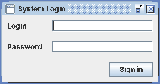
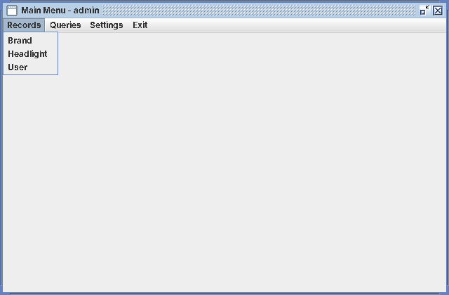
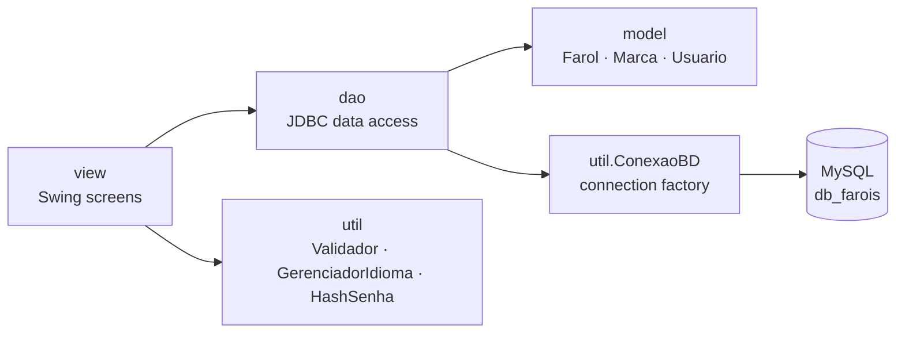
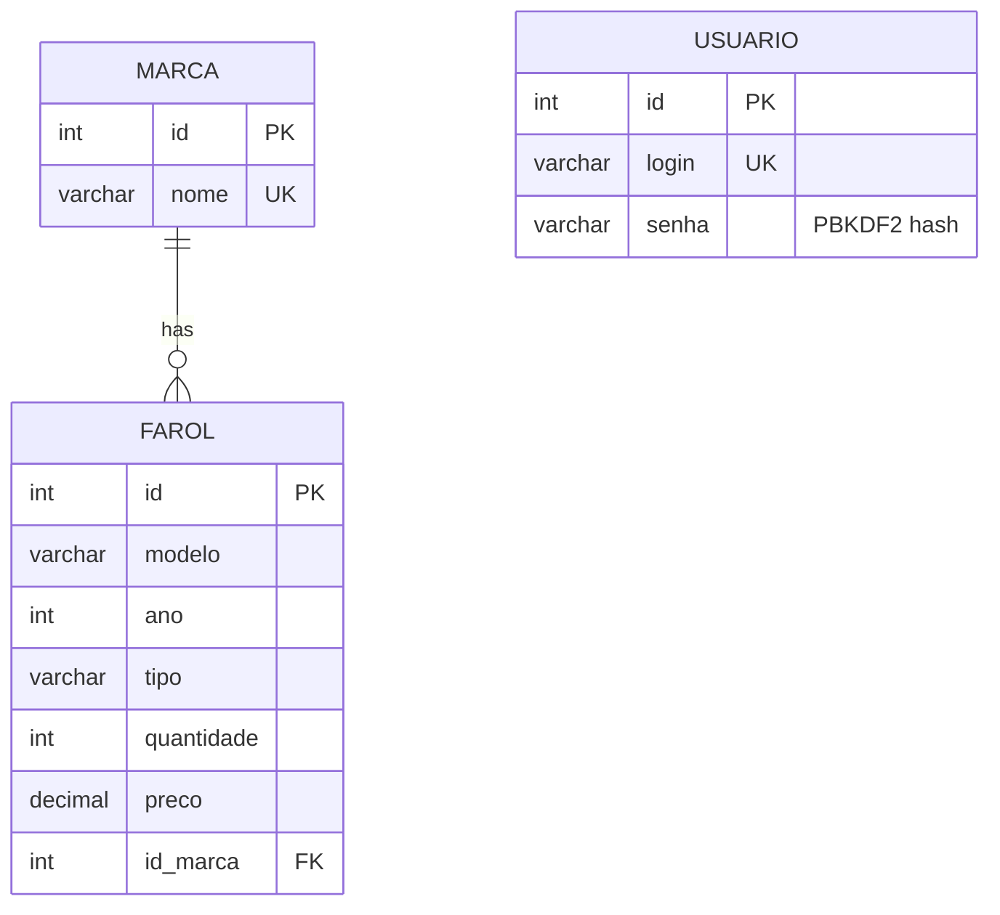

# SisFarol: Headlight Inventory System

[](https://github.com/igorparreirap/headlight-inventory-system/actions/workflows/ci.yml)


[](LICENSE)

**English** | [Português](README.pt-BR.md)

A desktop app for managing the inventory of an automotive headlight store, built
with **Java Swing**, **JDBC** and **MySQL**. It covers authentication, CRUD for
brands, headlights and users, search filters, sorted inventory reports and
switching the UI language between Portuguese and English while the app is running.

<p align="center">
  
  &nbsp;&nbsp;
  
</p>

## Features

- **Authentication:** login backed by the `usuario` table. Passwords are stored as salted **PBKDF2-HMAC-SHA256** hashes, never in plain text.
- **Brand, Headlight and User records:** full CRUD with a *Register* tab and a *Search* tab on each screen.
- **Data integrity:** required-field, numeric, year-range and price validation. Duplicates are blocked in the app and by `UNIQUE` constraints in the database.
- **Search:** headlights can be filtered by model, type, brand or year.
- **Inventory report:** stock listing sorted by model (A–Z) or by quantity (descending).
- **Internationalization (i18n):** every label comes from `ResourceBundle` files (`pt_BR`, `en_US`), and the language can be changed without restarting.

## Tech stack

| Layer        | Technology                                   |
|--------------|----------------------------------------------|
| Language     | Java 17+                                     |
| UI           | Swing (`JFrame`, `JDialog`, `JTable`, `GridBagLayout`) |
| Persistence  | JDBC + `PreparedStatement`, MySQL 8 (InnoDB, utf8mb4) |
| Build        | Maven (shade plugin builds an executable jar) |
| Tests        | JUnit 5                                      |
| CI           | GitHub Actions (Java 17 and 21)              |

## Architecture

The code is split into layers, each with a single responsibility:



```
src/
├── main/java/
│   ├── app/      Principal: entry point (starts the UI on the EDT)
│   ├── model/    POJOs mirroring the database tables
│   ├── dao/      CRUD and queries with PreparedStatement
│   ├── view/     Swing windows (login, menu, registrations, report, language)
│   └── util/     DB connection, validation, i18n, password hashing
├── main/resources/util/i18n/   mensagens_pt_BR / mensagens_en_US
└── test/java/    JUnit 5 unit tests
database/schema.sql             schema + seed data (13 brands, 110 headlights)
```

### Data model



`farol` has a composite unique key on `(modelo, ano, tipo, id_marca)`, so the same headlight can't be registered twice.

## Getting started

### Prerequisites

- JDK 17 or newer
- Maven 3.9+
- MySQL 8+ running locally

### 1. Create the database

```bash
mysql -u root -p < database/schema.sql
```

The script creates `db_farois`, the tables and the seed data. It can be run again safely because it drops and recreates the database.

### 2. Configure the connection

Credentials are **not** stored in the source code. Copy the template and fill in your MySQL password:

```bash
cp db.properties.example db.properties
```

```properties
db.url=jdbc:mysql://localhost:3306/db_farois?useSSL=false&serverTimezone=UTC
db.user=root
db.password=your_password
```

You can also set the environment variables `DB_URL`, `DB_USER` and `DB_PASSWORD`, which take precedence over the file.

### 3. Build and run

```bash
mvn clean package          # compiles, runs tests and builds target/sisfarol.jar
java -jar target/sisfarol.jar
```

or, during development:

```bash
mvn compile exec:java
```

Default login: **`admin` / `admin`**

### Running the tests

```bash
mvn test
```

## Design decisions

- **DAO pattern:** SQL is isolated from the UI, so each screen depends only on a DAO and the model classes.
- **`PreparedStatement` everywhere:** prevents SQL injection and keeps queries readable.
- **Password hashing without extra dependencies:** `HashSenha` uses the JDK's `PBKDF2WithHmacSHA256` with a per-user random salt and constant-time comparison.
- **Externalized configuration:** connection settings come from environment variables or a git-ignored file, following [12-factor](https://12factor.net/config) practice.

## Roadmap

- [ ] Add a service layer between views and DAOs
- [ ] Use a connection pool (HikariCP)
- [ ] Version database migrations with Flyway
- [ ] Add integration tests for the DAOs with Testcontainers
- [ ] Use `BigDecimal` for prices
- [ ] Switch to a modern look and feel (FlatLaf) with dark mode

## Background

I first built this as the mini software project for the **CMP1611** course, then
refactored it for publication: Maven build, externalized credentials, password
hashing, unit tests and CI.

## Author

**Igor Parreira de Paula**, [GitHub](https://github.com/igorparreirap)

## License

Distributed under the MIT License. See [LICENSE](LICENSE).
