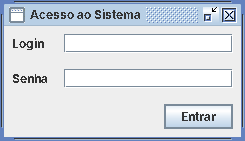
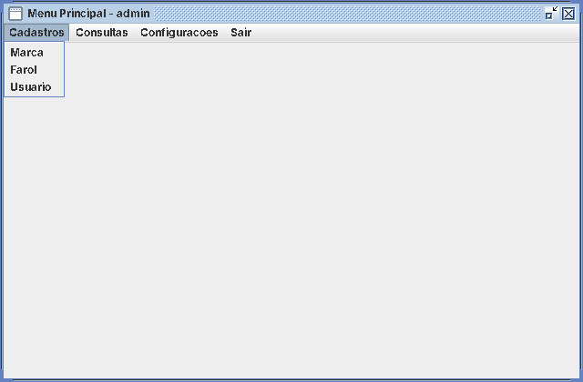
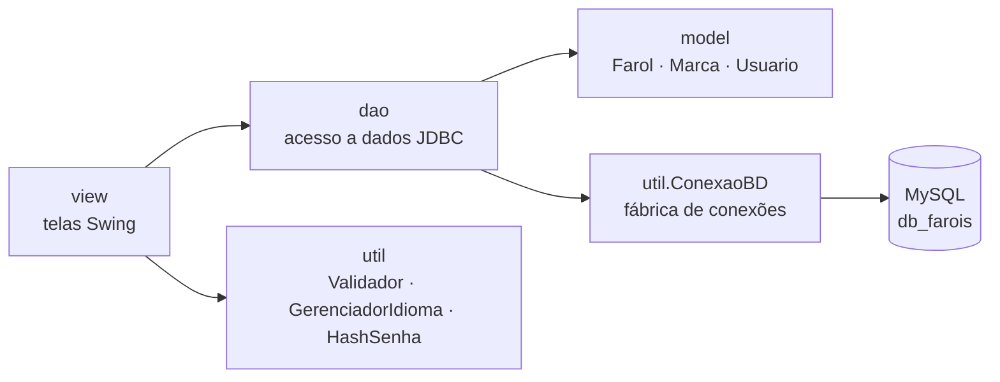
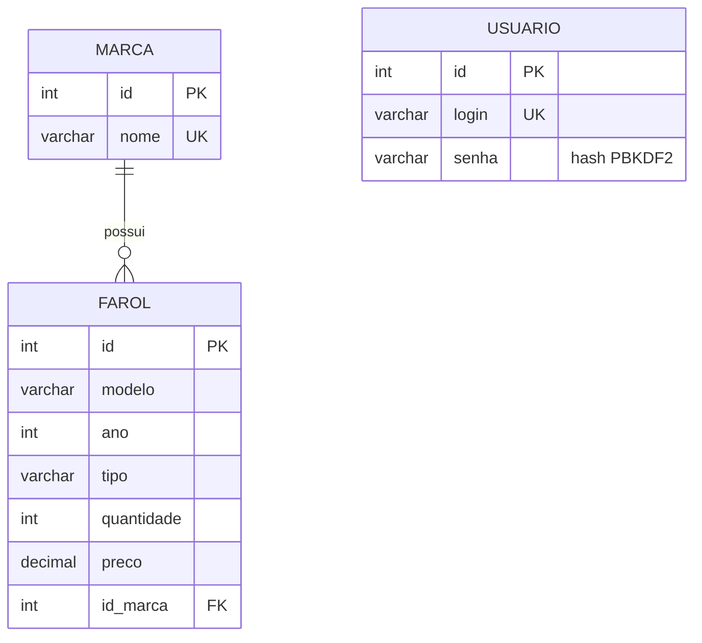

# SisFarol: Gerenciador de Estoque de Faróis

[](https://github.com/igorparreirap/headlight-inventory-system/actions/workflows/ci.yml)


[](LICENSE)

[English](README.md) | **Português**

Aplicação desktop para gerenciar o estoque de uma loja de faróis automotivos,
feita com **Java Swing**, **JDBC** e **MySQL**. Tem autenticação, CRUD de marcas,
faróis e usuários, filtros de pesquisa, relatório de estoque ordenado e troca de
idioma (português/inglês) com o sistema aberto.

<p align="center">
  
  &nbsp;&nbsp;
  
</p>

## Funcionalidades

- **Autenticação:** login validado na tabela `usuario`. As senhas são guardadas como hash **PBKDF2-HMAC-SHA256** com salt, nunca em texto puro.
- **Cadastros de Marca, Farol e Usuário:** CRUD completo, com abas *Cadastro* e *Pesquisa* em cada tela.
- **Integridade dos dados:** validação de campos obrigatórios, numéricos, faixa de ano e preço. Duplicidades são bloqueadas na aplicação e por restrições `UNIQUE` no banco.
- **Pesquisa:** faróis podem ser filtrados por modelo, tipo, marca ou ano.
- **Relatório de estoque:** listagem ordenada por modelo (A–Z) ou por quantidade (decrescente).
- **Internacionalização (i18n):** todos os textos vêm de arquivos `ResourceBundle` (`pt_BR`, `en_US`), e o idioma muda sem reiniciar.

## Tecnologias

| Camada       | Tecnologia                                   |
|--------------|----------------------------------------------|
| Linguagem    | Java 17+                                     |
| Interface    | Swing (`JFrame`, `JDialog`, `JTable`, `GridBagLayout`) |
| Persistência | JDBC + `PreparedStatement`, MySQL 8 (InnoDB, utf8mb4) |
| Build        | Maven (plugin shade gera um jar executável)  |
| Testes       | JUnit 5                                      |
| CI           | GitHub Actions (Java 17 e 21)                |

## Arquitetura

O código é dividido em camadas, cada uma com uma responsabilidade:



```
src/
├── main/java/
│   ├── app/      Principal: ponto de entrada (abre a UI na EDT)
│   ├── model/    POJOs que espelham as tabelas
│   ├── dao/      CRUD e consultas com PreparedStatement
│   ├── view/     Janelas Swing (login, menu, cadastros, relatório, idioma)
│   └── util/     conexão, validação, i18n, hash de senha
├── main/resources/util/i18n/   mensagens_pt_BR / mensagens_en_US
└── test/java/    testes unitários JUnit 5
database/schema.sql             estrutura + dados de teste (13 marcas, 110 faróis)
```

### Modelo de dados



A tabela `farol` tem chave única composta em `(modelo, ano, tipo, id_marca)`, o que impede cadastrar o mesmo farol duas vezes.

## Como executar

### Pré-requisitos

- JDK 17 ou superior
- Maven 3.9+
- MySQL 8+ rodando localmente

### 1. Criar o banco

```bash
mysql -u root -p < database/schema.sql
```

O script cria o banco `db_farois`, as tabelas e os dados de teste. Pode ser executado de novo sem problema, porque ele apaga e recria o banco.

### 2. Configurar a conexão

As credenciais **não** ficam no código-fonte. Copie o modelo e preencha a senha do seu MySQL:

```bash
cp db.properties.example db.properties
```

```properties
db.url=jdbc:mysql://localhost:3306/db_farois?useSSL=false&serverTimezone=UTC
db.user=root
db.password=sua_senha
```

Também dá para usar as variáveis de ambiente `DB_URL`, `DB_USER` e `DB_PASSWORD`, que têm prioridade sobre o arquivo.

### 3. Compilar e rodar

```bash
mvn clean package          # compila, roda os testes e gera target/sisfarol.jar
java -jar target/sisfarol.jar
```

ou, durante o desenvolvimento:

```bash
mvn compile exec:java
```

Login padrão: **`admin` / `admin`**

### Rodando os testes

```bash
mvn test
```

## Decisões de projeto

- **Padrão DAO:** o SQL fica separado da interface, e cada tela depende só de um DAO e das classes de modelo.
- **`PreparedStatement` em todas as consultas:** evita SQL injection e deixa as queries legíveis.
- **Hash de senha sem dependências externas:** `HashSenha` usa o `PBKDF2WithHmacSHA256` do próprio JDK, com salt aleatório por usuário e comparação em tempo constante.
- **Configuração externalizada:** os dados de conexão vêm de variáveis de ambiente ou de um arquivo ignorado pelo git, como recomenda o [12-factor](https://12factor.net/pt_br/config).

## Próximos passos

- [ ] Criar uma camada de serviço entre telas e DAOs
- [ ] Usar pool de conexões (HikariCP)
- [ ] Versionar as migrações do banco com Flyway
- [ ] Testes de integração dos DAOs com Testcontainers
- [ ] Usar `BigDecimal` para preços
- [ ] Look and feel moderno (FlatLaf) com modo escuro

## Contexto

Fiz este projeto como mini-projeto de software da disciplina **CMP1611** e depois
o refatorei para publicar: build com Maven, credenciais fora do código, hash de
senhas, testes unitários e integração contínua.

## Autor

**Igor Parreira de Paula**, [GitHub](https://github.com/igorparreirap)

## Licença

Distribuído sob a licença MIT. Veja [LICENSE](LICENSE).
